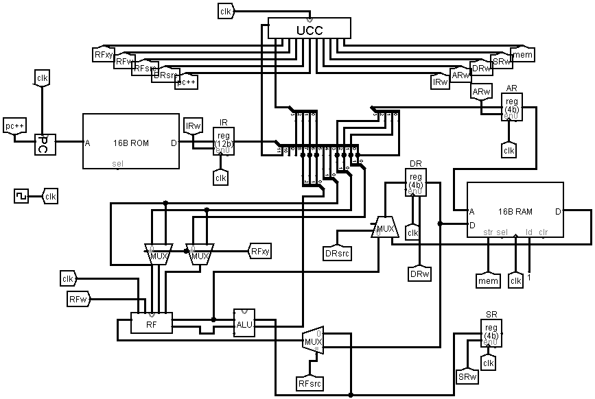

# 🖥️ 4-bit Processor Design using Logisim

## 📌 Project Overview

This academic project focuses on the design and simulation of a 4-bit processor using Logisim.

Developed during the second year of my Bachelor's degree in Computer Science (L2 – Semester 3), as part of the Computer Architecture course.

## ⚙️ Processor Architecture

- Arithmetic Logic Unit (ALU)
- Program Counter (PC)
- Instruction Register (IR)
- Register File (RF)
- Control Unit (UCC)
- RAM and ROM
- Multiplexers and digital logic circuits

## 🧮 ALU Operations

- Addition
- Subtraction
- Multiplication
- AND
- OR
- NOT
- Left Shift
- Right Shift

## 🛠️ Tools Used

- Logisim
- Digital Logic Design
- Computer Architecture

## 🚀 How to Run

1. Download the Processeur.circ file.
2. Open it using Logisim.
3. Select the main processor circuit.
4. Enable simulation and clock ticks.

## ✅ Testing and Validation

Preliminary manual tests were performed on the Program Counter, instruction loading, and several arithmetic and logical operations.

Full processor validation remains a future improvement.

## 🎓 Skills Developed

- Digital circuit design
- Binary arithmetic
- Processor architecture
- Memory and register management
- Circuit simulation and debugging

## 📷 Processor Design

